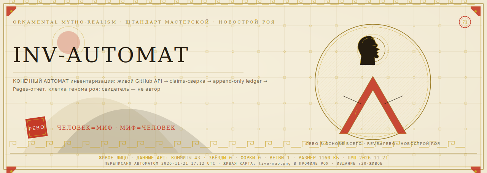
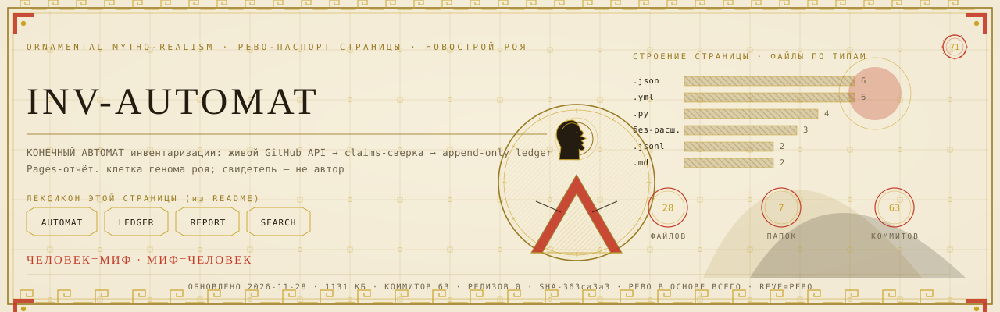

<div align="center">

<a href="https://github.com/rtynbirf/inv-automat"></a>

</div>

<!--ФОРЖ:ПАСПОРТ:НАЧАЛО-->
<div align="center">
  
</div>

| ФАЙЛОВ | ПАПОК | КОММИТОВ | ОБНОВЛЕНО | РЕЛИЗОВ |
|---:|---:|---:|---|---:|
| 23 | 5 | 37 | 2026-11-21 | 0 |
<!--ФОРЖ:ПАСПОРТ:КОНЕЦ-->

# inv-automat — КОНЕЧНЫЙ АВТОМАТ инвентаризации

МЕХАНИЗМ inv-01 переведён в конечный автомат и встроен в геном роя.
Ни одна цифра не берётся из README без сверки с живым фактом.

## Автомат (FSM)

```
IDLE --start--> BOOT --ok--> INVENTORY --ok--> CLAIMS --ok--> VERIFY
      --ok--> LEDGER --ok--> REPORT --ok--> PUBLISH --ok--> DONE
любой проблемный переход --> DEGRADED --report--> REPORT (честный частичный прогон)
защита от зацикливания: MAX_STEPS=24 --> HALT
```

Таблица переходов — единственный источник движения (`automat/inv_automat.py`).
Каждый переход дописывается в `automat/ledger/runs.jsonl` (append-only):

```json
{"ts": "...", "run_id": "R...", "from": "BOOT", "guard": "ok", "to": "INVENTORY", "evidence": {"core_remaining": 4995}}
```

Состояние персистится в `automat/state.json`; `last_summary` даёт drift-детект
между прогонами (дельты: репо, коммиты, claims, противоречия).

## Источники фактов (бюджет-осведомлённые)

- core api.github.com: /users, /repos, /events, /rate_limit (5000/ч с токеном)
- search api.github.com: /search/repositories, /search/commits
- git: clone --bare --filter=blob:none → rev-list --count, ls-tree (точные коммиты и деревья, ноль бинарников)
- raw: README и data-файлы для deep-счёта (корпус RUVSON, catalog.json)
- html: вкладка Repositories, SVG/HTML-календарь контрибуций

## Чего взято у мировых практик, а что своё

Заимствовано: плановые workflow по расписанию (паттерн OpenSSF Scorecard),
reusable-воркфлоу для org-wide governance (github.blog), least-privilege
`permissions: contents: write`, идемпотентные коммиты автоматов.

Своё эмерджентное: FSM с ledger'ом **переходов** (не только результатов),
периферийные свидетели в каждом репо роя (пишут свидетельства в самих репо,
append-only `INV_LEDGER.jsonl`), разнесённый cron-такт по хэшу имени клетки
(рой дышит не одним тактом), честное состояние DEGRADED с частичными
свидетельствами, drift-детект между прогонами.

## Интеграция в геном

- центральный автомат: этот репо, `automat/inv_automat.py` + `automat/inv_mechanism.py`
- свидетель в каждой клетке: `.github/workflows/inv-witness.yml` — коммиты,
  файлы, claims README → `INV_LEDGER.jsonl` в самом репо
- отчёт: `report/index.html` → GitHub Pages этого репо
- расписание: центр — пн 03:23 UTC; свидетели — пн 02:MM UTC (MM = md5(name) % 60)

## Honesty

- DEGRADED — не ошибка, а честная метка частичного прогона
- UNVERIFIABLE — в GitHub API факта нет (нужен CI-прогон), не «не проверено потому что лень»
- search-индекс может отставать от реальности на минуты; это помечено в отчёте
